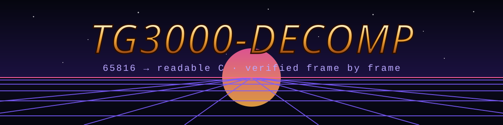

<p align="center"></p>

<p align="center">
  <a href="https://github.com/MaChInEgUn3/tg3000-decomp/actions/workflows/build.yml"></a>
  <a href="LICENSE"></a>
  
  <a href="CONTRIBUTING.md"></a>
</p>

**English** · [Português (BR)](README.pt-br.md)

# Top Gear 3000 — disassembly and readable C

A reverse-engineering project for the SNES game **Top Gear 3000** (USA, 1995):
a fully annotated reference disassembly of the 65816 code, and the game logic
rewritten as **readable, portable C**, proven correct routine by routine against the
original.

Native ports (Linux, Windows, maybe the Mega Drive one day) will live in a separate
repository that builds on the C from here. **The ports will contain no emulator at
all**: the DSP-4 maths, the video and the sound driver become native code.

> [!IMPORTANT]
> This repository contains **no game data**. You need your own legally obtained ROM:
> `Top Gear 3000 (USA)`, 1,048,576 bytes, no copier header,
> SHA-1 `058aadf1ee719cb9e0c7333e665797f990a6381d`.

## Progress

<!-- BEGIN GENERATED PROGRESS -->

| Metric | Current |
|---|---:|
| ROM bytes classified (code + data) | **0 / 1,048,576 (0.00%)** |
| Code bytes | 0 (`0x0`) |
| Data bytes | 0 (`0x0`) |
| Routines ported to C and passing the differential test | **0** |

_Generated by `tools/progress.py` from `map/` and `src/`._

<!-- END GENERATED PROGRESS -->

| Phase | State |
|---|---|
| 1. Bench: run the original ROM headless as ground truth | ✅ boots, renders, DSP-4 hooked, deterministic |
| 2. Map: classify every ROM byte as code or data from execution traces | ⏳ next |
| 3. Listing: generated, labelled reference disassembly | — |
| 4. C: port routines, each passing the differential test | — |

## How correctness is proven

The original is hand-written 65816 assembly, so C can never be byte-identical to it.
Instead, every ported routine goes through a **differential test** on the bench:

1. The bench runs the original ROM. When it reaches the entry of a ported routine,
   it snapshots the whole machine.
2. The C version runs on a copy of that state.
3. The original runs on to the routine's return.
4. Work RAM, returned registers/flags and every hardware/DSP-4 write are compared.
   Any difference fails the routine.

Whole-frame checks (a hash of work RAM per video frame) cover longer stretches once
they are ported. The bench is deterministic: the same input movie gives the same
RAM, frame for frame.

The bench **may** emulate — it is the measuring instrument, never part of the game.

## Building the bench

Linux (Debian/Ubuntu): `gcc`, `g++`, `make`, `git`, `python3`.

```sh
tools/bench/fetch.sh          # third-party code into ext/, at pinned commits
make -C tools/bench           # -> build/bench/bench
build/bench/bench TG3000.sfc 3600 \
    --movie tools/bench/movies/start_taps.txt \
    --dump /tmp/frames --every 120 \
    --dsp4-log /tmp/dsp4.log --hashes /tmp/wram.txt
```

`--dump` writes PNG screenshots outside the repository; they are game assets and are
never committed.

## Repository layout

```
docs/          DECISIONS.md (scope and facts), WORKFLOW.md (how to work)
tools/bench/   the reference runner: LakeSnes + DSP-4 hook, movies, frame dumps
tools/         mapper, listing generator, progress report
map/           code/data map of the ROM (coming)
asm/           generated reference disassembly (coming)
src/           readable, portable C of the game logic (coming)
```

## Contributing

PRs are welcome — see [CONTRIBUTING.md](CONTRIBUTING.md). Never include ROM data,
screenshots or extracted assets.

## Credits and licence

GPL-3.0-or-later — see [LICENSE](LICENSE) and [CREDITS.md](CREDITS.md).
Top Gear 3000 is © 1994 Kemco / Gremlin Graphics; this is an unofficial fan project,
not affiliated with or endorsed by them or Nintendo.
