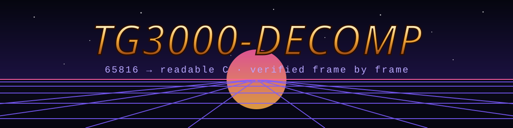

<p align="center"></p>

<p align="center">
  <a href="https://github.com/MaChInEgUn3/tg3000-decomp/actions/workflows/build.yml"></a>
  <a href="LICENSE"></a>
  
  <a href="CONTRIBUTING.md"></a>
</p>

[English](README.md) · **Português (BR)**

# Top Gear 3000 — disassembly e C legível

Projeto de engenharia reversa do jogo de SNES **Top Gear 3000** (EUA, 1995):
um disassembly do código 65816, todo anotado, que remonta a ROM byte a byte, e a lógica do jogo
reescrita em **C legível e portável**, com cada rotina comprovada contra o original.

Os ports nativos (Linux, Windows e, quem sabe um dia, Mega Drive) vão ficar num
repositório separado que usa o C daqui. **Os ports não vão ter nada de emulador**:
a matemática do DSP-4, o vídeo e o driver de som viram código nativo.

> [!IMPORTANT]
> Este repositório **não contém nenhum dado do jogo**. Você precisa da sua própria ROM,
> obtida legalmente: `Top Gear 3000 (USA)`, 1.048.576 bytes, sem header de copiadora,
> SHA-1 `058aadf1ee719cb9e0c7333e665797f990a6381d`.

## Progresso

<!-- BEGIN GENERATED PROGRESS -->

| Métrica | Atual |
|---|---:|
| Bytes da ROM classificados (código + dados) | **437,335 / 1,048,576 (41.71%)** |
| Bytes de código | 55,874 (`0xDA42`) |
| Bytes de dados | 381,461 (`0x5D215`) |
| Pontos de entrada de rotinas em C, aprovados no teste diferencial | **6** |

_Gerado por `tools/progress.py` a partir de `map/` e `src/`._

<!-- END GENERATED PROGRESS -->

| Fase | Estado |
|---|---|
| 1. Bancada: rodar a ROM original sem tela, como referência | ✅ liga, desenha, DSP-4 encaixado, determinística |
| 2. Mapa: classificar cada byte da ROM como código ou dado, a partir de traces | ⏳ em andamento (menus + várias corridas no piloto automático) |
| 3. Listagem: disassembly gerado, com nomes, que remonta byte a byte | ✅ remonta a ROM exata; cresce junto com o mapa |
| 4. C: portar as rotinas, cada uma aprovada no teste diferencial | ⏳ começou: harness + primeira rotina (`rng_next`) |

## Como a fidelidade é comprovada

O original é assembly 65816 escrito à mão, então o C nunca vai ser idêntico byte a
byte. Em vez disso, cada rotina portada passa por um **teste diferencial** na bancada:

1. A bancada roda a ROM original. Quando chega na entrada de uma rotina já portada,
   tira uma foto do estado da máquina inteira.
2. A versão em C roda numa cópia desse estado.
3. O original segue até o retorno da rotina.
4. A RAM, os registradores/flags de retorno e toda escrita no hardware e no DSP-4 são
   comparados. Qualquer diferença reprova a rotina.

Trechos maiores, quando estiverem portados, são conferidos frame a frame (um hash da
RAM por frame de vídeo). A bancada é determinística: a mesma sequência de botões dá a
mesma RAM, frame a frame.

A bancada **pode** emular: ela é o instrumento de medição, nunca parte do jogo.

## Compilando a bancada

Linux (Debian/Ubuntu): `gcc`, `g++`, `make`, `git`, `python3`.

```sh
tools/bench/fetch.sh          # código de terceiros em ext/, em commits fixos
make -C tools/bench           # -> build/bench/bench
build/bench/bench TG3000.sfc 3600 \
    --movie tools/bench/movies/start_taps.txt \
    --dump /tmp/frames --every 120 \
    --dsp4-log /tmp/dsp4.log --hashes /tmp/wram.txt
```

Para remontar a ROM a partir de `asm/` (precisa da sua ROM para os dados que ele puxa com `incbin`):

```sh
tools/build_asm.sh            # confere o SHA-1 e que todo o código sai do texto do asm
```

O `--dump` grava prints em PNG fora do repositório. Eles são assets do jogo e nunca
são commitados.

## Organização do repositório

```
docs/          DECISIONS.md (escopo e fatos), WORKFLOW.md (como trabalhar)
tools/bench/   o executor de referência: LakeSnes + DSP-4, movies, prints
tools/         mapeador, gerador da listagem, relatório de progresso
map/           mapa de código/dados da ROM (em breve)
asm/           disassembly gerado (asar), remonta byte a byte
src/           C legível e portável da lógica do jogo (primeiras rotinas)
```

## Contribuindo

PRs são bem-vindos, veja o [CONTRIBUTING.md](CONTRIBUTING.md) (em inglês). Nunca
inclua dados da ROM, prints ou assets extraídos.

## Créditos e licença

GPL-3.0-or-later, veja [LICENSE](LICENSE) e [CREDITS.md](CREDITS.md).
Top Gear 3000 é © 1994 Kemco / Gremlin Graphics. Este é um projeto não oficial de fã,
sem ligação com elas ou com a Nintendo.
